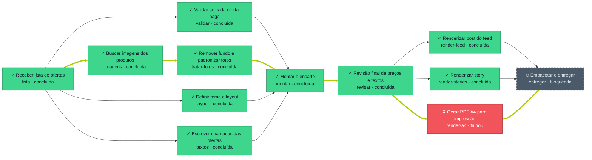

# DAG — Encarte semanal — Loja Exemplo (simulação)

> Gerar, revisar e entregar o encarte da semana em três formatos: feed, stories e A4 para impressão

**Execução** `demo-encarte` · **versão** v1 · **estado** encerrado · atualizado em 2026-10-08T15:43:35-03:00

**Progresso:** 10/12 concluídas (83%) · 319k tokens

| Status | Tarefas |
|---|---|
| ✓ concluída | 10 |
| ✗ falhou | 1 |
| ⊘ bloqueada | 1 |

Caminho crítico: lista → imagens → tratar-fotos → montar → revisar → render-a4 → entregar
