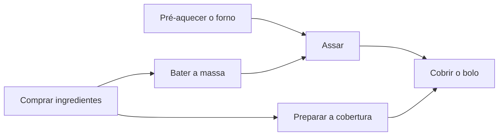
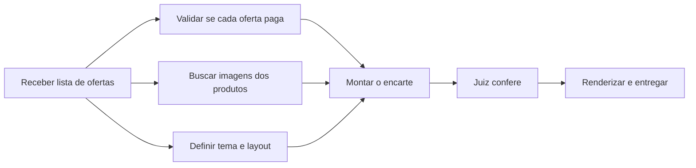

# O que é um DAG

> Guia de referência sobre DAGs (grafos direcionados acíclicos) e o uso deles para organizar o trabalho de agentes de IA.

---

## 1. Definição curta

Um **DAG** é um mapa de tarefas que mostra **o que depende do quê**. Com esse mapa dá para saber, a qualquer momento:

- o que já pode começar;
- o que precisa esperar;
- o que pode acontecer ao mesmo tempo.

A sigla vem do inglês **Directed Acyclic Graph**, em português **grafo direcionado acíclico**.

## 2. As três palavras da sigla

| Palavra | Significado | Na prática |
|---|---|---|
| **Grafo** | Um conjunto de pontos ligados por linhas | Cada ponto é uma tarefa, cada linha é uma ligação entre tarefas |
| **Direcionado** | As linhas têm sentido, são setas | `A → B` quer dizer "B só começa depois que A terminar" |
| **Acíclico** | Não existe caminho que volte ao ponto de partida | Nunca acontece de A esperar B enquanto B espera A |

A terceira palavra é a que dá segurança ao mapa. Se existisse um ciclo, as tarefas envolvidas ficariam esperando umas pelas outras para sempre e nada sairia do lugar.

## 3. Um exemplo do dia a dia: fazer um bolo



Lendo o mapa:

- **Começo:** "Comprar ingredientes" e "Pré-aquecer o forno" não dependem de nada. Podem começar juntas.
- **Em série:** a massa precisa estar batida antes de ir ao forno. Não existe atalho.
- **Em paralelo:** enquanto o bolo assa, outra pessoa prepara a cobertura.
- **Ponto de encontro:** "Cobrir o bolo" espera duas coisas, o bolo assado e a cobertura pronta.

## 4. Vocabulário básico

| Termo | O que é | No exemplo do bolo |
|---|---|---|
| **Nó** | Uma tarefa | "Bater a massa" |
| **Aresta** | A seta entre duas tarefas | Massa → Assar |
| **Dependência** | Aquilo que uma tarefa precisa esperar | "Assar" depende da massa e do forno |
| **Raiz** | Tarefa sem dependências, ponto de partida | "Comprar ingredientes" |
| **Folha** | Tarefa da qual nada depende, ponto de chegada | "Cobrir o bolo" |
| **Nível** | Distância de uma tarefa até o começo | Massa e cobertura estão no mesmo nível |
| **Caminho crítico** | A sequência mais longa de tarefas encadeadas | Ingredientes → massa → assar → cobrir |
| **Ordenação topológica** | Uma ordem de execução que respeita todas as setas | Ingredientes, forno, massa, cobertura, assar, cobrir |

### Por que o caminho crítico importa

O caminho crítico define o **tempo mínimo** do trabalho todo. Colocar mais gente nas tarefas paralelas não encurta esse tempo. Para terminar antes, é preciso acelerar alguma tarefa que esteja no caminho crítico.

## 5. Onde DAGs já aparecem

Quem trabalha com tecnologia provavelmente já usou DAGs com outros nomes:

- **Workflows do n8n:** cada nó só roda quando os anteriores entregam os dados.
- **Planilhas:** quando uma célula usa o resultado de outra, a planilha monta um DAG para saber a ordem de recalcular. A mensagem de "referência circular" é a planilha avisando que encontrou um ciclo.
- **Pipelines de CI/CD:** testes, build e deploy em etapas que dependem umas das outras.
- **docker-compose:** o campo `depends_on` define a ordem de subida dos serviços.
- **Airflow:** a ferramenta chama cada fluxo de trabalho literalmente de "DAG".
- **Histórico do Git:** cada commit aponta para o anterior, formando um DAG.

## 6. DAGs e agentes de IA

### O problema
Quando um agente recebe uma tarefa grande sem planejamento, costuma acontecer uma destas coisas:

- ele executa tudo em fila, uma etapa de cada vez, e demora mais do que precisa;
- ele dispara vários subagentes sem critério, e dois deles alteram o mesmo arquivo, um desfazendo o trabalho do outro;
- ninguém sabe dizer em que ponto o trabalho está.

### O que o DAG resolve
Pedir ao agente que monte um DAG **antes** de executar traz três ganhos:

1. **Velocidade:** tudo que não depende de nada vai para subagentes ao mesmo tempo.
2. **Menos conflito:** fica explícito quem mexe em quê. Duas tarefas que alteram o mesmo arquivo nunca rodam juntas.
3. **Visibilidade:** o mapa mostra o que está pronto, o que está rodando e o que está esperando.

### Divisão de trabalho entre modelos
- O **planejamento** do DAG exige raciocínio sobre dependências, então fica com o modelo mais capaz disponível.
- A **execução** de cada tarefa pode ir para modelos mais rápidos e baratos.
- Um **juiz** (outro modelo, rápido e barato) pode conferir se cada entrega cumpre o combinado antes de liberar as próximas tarefas.

### Retrabalho dentro de um DAG
Quando o juiz reprova uma entrega, a mesma tarefa é executada de novo. O mapa continua sem voltas: a tarefa repete, e o fluxo segue adiante dali. Por isso um processo com revisão continua sendo um DAG.

## 7. Um exemplo de trabalho real: gerar um encarte



- **Nível 0:** receber a lista.
- **Nível 1:** validação, imagens e layout dependem só da lista e rodam em paralelo, cada uma com um subagente.
- **Nível 2:** a montagem espera as três.
- **Níveis 3 e 4:** conferência e entrega, em série.

Sem o DAG, um agente faria as sete etapas uma depois da outra. Com o DAG, as três do nível 1 acontecem juntas.

## 8. Quando usar e quando dispensar

**Vale a pena quando:**

- a tarefa tem muitas partes;
- várias partes são independentes entre si;
- a execução é longa ou vai rodar sem ninguém acompanhando.

**Pode dispensar quando:**

- a tarefa tem poucos passos e todos em sequência;
- montar o plano levaria mais tempo do que executar direto.

Mais subagentes em paralelo terminam o trabalho mais cedo, mas consomem mais tokens no mesmo intervalo. O ganho aparece em tarefas grandes.

## 9. Como pedir um DAG para um agente

```
Antes de executar, crie um DAG desta tarefa:
- liste as tarefas e as dependências entre elas;
- para cada tarefa, indique os arquivos que ela vai alterar;
- indique o que pode rodar em paralelo sem conflito;
- aponte o caminho crítico.
Mostre o DAG para eu aprovar e só então execute,
usando o máximo de subagentes em paralelo que o mapa permitir.
```

## 10. Erros comuns

| Erro | Consequência | Como evitar |
|---|---|---|
| Esquecer que duas tarefas alteram o mesmo arquivo | Uma sobrescreve o trabalho da outra | Listar os arquivos de cada tarefa e criar dependência entre as que coincidem |
| Tarefas grandes demais | Pouco paralelismo e entregas difíceis de conferir | Quebrar até cada tarefa caber numa única delegação |
| Tarefa sem critério de pronto | Ninguém sabe dizer se ela terminou | Definir uma condição verificável para cada tarefa |
| Montar DAG para tarefa pequena | Tempo e tokens gastos sem retorno | Executar direto quando houver poucos passos lineares |
| Confundir retrabalho com ciclo | Plano desenhado com setas voltando | Tratar revisão como repetição da mesma tarefa |

## 11. Resumo

- DAG é um mapa de tarefas com setas de dependência e sem voltas.
- Ele mostra o que pode começar, o que espera e o que roda em paralelo.
- O caminho crítico define o tempo mínimo do trabalho.
- Com agentes de IA, pedir um DAG antes de executar traz velocidade, menos conflito e visibilidade do progresso.
